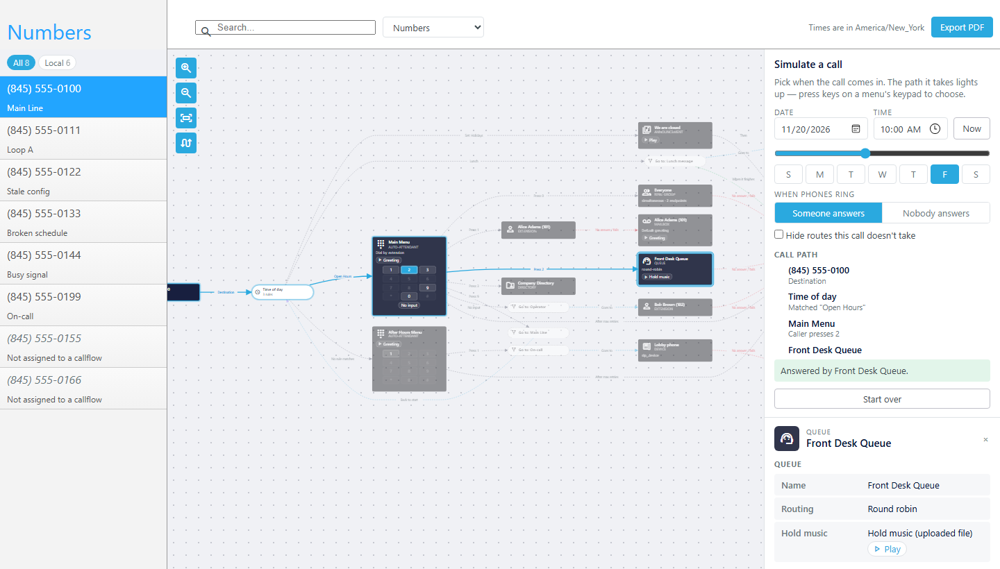
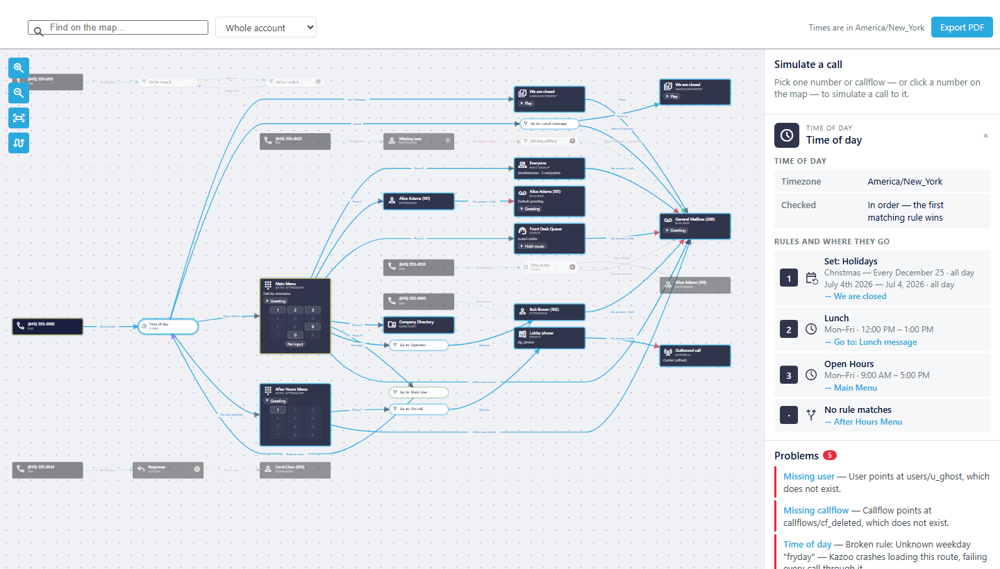
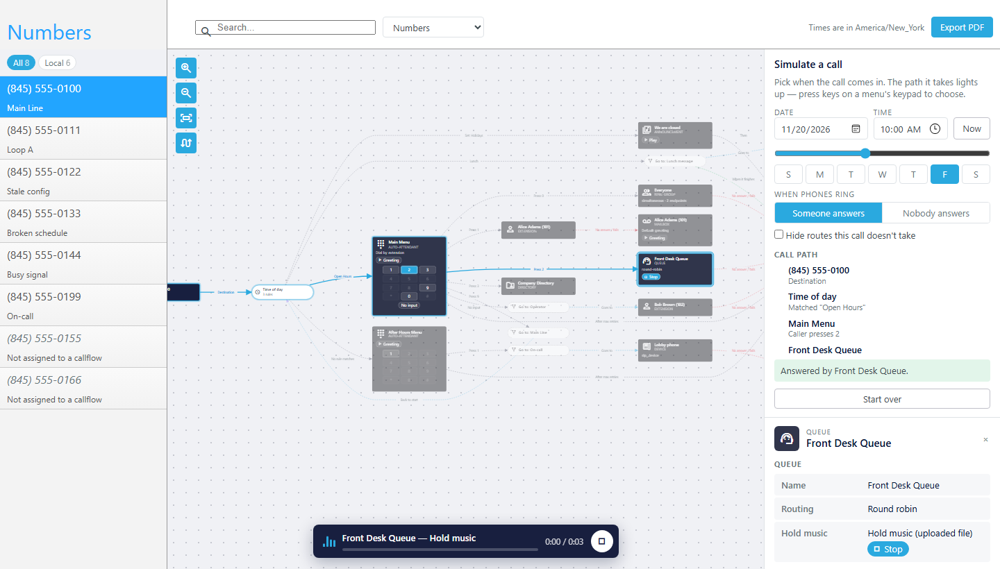

# Call Routing Visualizer for Kazoo (Monster UI app)

See where every call to a Kazoo account goes, and simulate any call at any moment.

Pick a phone number, a callflow or the whole account, and the app draws its routing as a map:
time-of-day rules, menus, ring groups, queues, voicemail, callflow jumps. Choose a date and time,
press keys on a menu's keypad, and the path the call takes lights up step by step, using
Kazoo's own routing rules (ported from its Erlang source and tested against it). Play every
greeting on the way, read each step's settings in plain language, and find broken configuration
before a customer does.



## Features

- **Three ways in**: a **number** (DIDs, filtered Local / Toll-free / International; numbers not on
  any callflow are listed too), a **callflow** (including extensions and feature codes), or the
  **whole account** on one full-width map, with a search that finds steps on it.
- **Simulate a call** at any date and time, using Monster's own date and time pickers. Time-of-day
  rules are evaluated the way Kazoo evaluates them, quirks included, so the map shows what Kazoo
  *will* do, not what the rule's name suggests.
- **Menus are phone keypads**: configured keys are live, unset keys are disabled. Press a key to
  follow the call; "no input" and "after max retries" are there too. A menu that loops back to
  itself ("press 9 to repeat") is understood as intentional.
- **Phones answer or not**: simulate "someone answers", "nobody answers", or **right now**, which
  uses each phone's live registration.
- **Play every greeting**: menu greetings and messages, voicemail greetings (Kazoo's own default
  greeting when a box has none), queue hold music, ring-group ringback, user/device hold music,
  and a browser-voice preview of text-to-speech steps. A now-playing bar shows progress, with Stop.
- **Readable details** for every step, laid out like the Callflows app's dialogs: ring-group members
  with delay and ring time, menu options as keys with their destinations, time rules as schedules
  ("Mon–Fri · 9:00 AM – 5:00 PM") with where each one goes. Click a destination to jump to it.
- **Problems** found while drawing: deleted users/devices/media, time rules Kazoo crashes or hangs
  on, unreachable branches, jump loops with no caller choice in them.
- **Export PDF**: a print view of the map and the simulated call, to share without a login.
- **Fast on big accounts**: start-up loads five lists; opening a route fetches only what it needs
  and caches it. Read-only — the app never changes anything in Kazoo.
- **Follows masquerading**: switch accounts, use `?m=<accountId>`, or Shift+M back.

| Whole account | Greetings and details |
| --- | --- |
|  |  |

Screenshots use a fictional demo account (`test/fixtures/synthetic-account.json`).

## Requirements

- **Kazoo** 4.x (developed against 4.5) with the Crossbar API.
- **Monster UI** — tested on 5.4.19.9 (current releases) as a production build and from source.
- Queues: **Qubicle** (`qubicle_queues`) is shown in full; other modules are drawn generically.
- Optional: Dimensions' **DT-Callflows** app. When it is installed, the visualizer reuses its
  stylesheet and icon font, so it looks exactly like the Callflows app (and follows any
  Dimensions branding, including the embedded portal's). Without it the app uses its own
  equivalent layout and Monster's built-in icons — nothing else changes.

## Install

The Monster app is the [`app/`](app/) folder. It has no build step and no Handlebars templates.

### 1. Put the files in Monster

**A built Monster** (the files your web server serves) — copy the folder in:

```bash
git clone https://github.com/{owner}/monster-ui-call-route-visualizer.git
cp -r monster-ui-call-route-visualizer/app /var/www/monster-ui/apps/call-route-visualizer
```

**Monster from source** — copy it into `src/apps/` and build as usual; the app is bundled into
`main.js` like the others:

```bash
cp -r monster-ui-call-route-visualizer/app monster-ui/src/apps/call-route-visualizer
cd monster-ui && gulp build-prod
```

The folder must be named `call-route-visualizer` (the app's name).

### 2. Register it in the app store

On a Kazoo server that can read the app folder:

```bash
sup crossbar_maintenance init_app '/var/www/monster-ui/apps/call-route-visualizer' 'https://kazoo.example.com:8443/v2/'
```

This reads [`app/metadata/app.json`](app/metadata/app.json) (name, description, icon,
screenshots, `masqueradable: true`). The second argument is your Crossbar API URL as the browser
sees it.

### 3. Enable it

In Monster's **App Exchange**, open *Call Routing Visualizer* and enable it for the account (and
users) that should have it. It is meant for admins and resellers.

### Trying it first

Monster's official `bypassAppStorePermissions: true` config flag lets
`#/apps/call-route-visualizer` open an app that isn't registered yet — handy on a development
Monster, never in production.

## Using it

- Pick **Numbers**, **Callflows** or **Whole account** in the dropdown beside the search box.
  ↑/↓ and Enter move through the list.
- The **Simulate a call** panel sets the date and time (the account's timezone), the weekday, and
  whether phones answer. Press keys on a menu's keypad on the map, or in the panel.
- Click any step for its details; click a number on the map to simulate calls to it.
- Zoom with the buttons or the mouse wheel; drag to pan; switch left-to-right / top-to-bottom.

## How it works

```
app/
  app.js                  Monster glue: start-up lists, on-demand fetching, pickers, masquerading
  lib/temporal.js         Kazoo's temporal_route evaluator (port of cf_temporal_route + kz_date)
  lib/graph.js            callflows -> graph; the call simulator; Kazoo branch semantics
  lib/loader.js           fetch-on-demand: what a route needs, following references, cached
  lib/details.js          plain-language details per module
  lib/canvas.js           dagre layout, HTML step cards, SVG edges, pan/zoom
  lib/view.js             the UI (list, simulator, details, player, problems, PDF)
  lib/vendor/dagre.min.js graph layout (MIT)
  style/                  app.css + Monster's icon sprites (fallback icons)
  i18n/en-US.json         strings
  metadata/               app-store record, icon, screenshots
test/                     node --test, with a fictional account
tools/kazoo-oracle/       differential test against Kazoo's own Erlang, in Docker
dev/preview.html          the UI with the fictional account — no Monster, no Kazoo
dev/monster-shim.html     loads app.js through RequireJS with a fake `monster` module
```

`app/lib/` has no Monster dependencies: the same code runs in Monster, the preview page and Node.

**Faithful, not "correct"**: the evaluator reproduces Kazoo's behaviour, including quirks (empty
weekdays means every day; a "fifth Monday" rule also firing on some 1sts), because the point is to
predict what Kazoo will do. A few semantics that are easy to get wrong, all verified in Kazoo's
source and documented at the top of `app/lib/graph.js`:

- jumping to another callflow is a **subroutine call** — when it ends, the call comes back and
  continues after the jump;
- a branch's `_` child is a fallback for most modules but **not** for menu digits;
- menus have `timeout` and `max_retries` children; jump loops stop after 50 branches.

## Development

```bash
npm install
npm test
```

Preview the UI with the fictional account (serve the repository root, then open
`http://127.0.0.1:5173/dev/preview.html`):

```bash
python -m http.server 5173 --bind 127.0.0.1
```

Preview options: `?at=2026-11-20T10:00` pins the simulated clock; `?open=%2B18455550100`,
`?node=menu`, `?press=2`, `?play=1`, `?zoom=1.5` put the page in a given state;
`?standalone=1` shows the look without DT-Callflows; `?theme=embedded` applies Dimensions'
embedded-portal colours.

Differential test against Kazoo's Erlang (needs Docker; see
[`tools/kazoo-oracle/README.md`](tools/kazoo-oracle/README.md)):

```bash
node tools/kazoo-oracle/diff.js <oracle-dir> 300000
```

To try it inside a real Monster, run Monster UI's dev server (Node 14) with `app/` copied or
mounted at `src/apps/call-route-visualizer`, and set `bypassAppStorePermissions: true` in
`src/js/config.js`.

## Credits

- [dagre](https://github.com/dagrejs/dagre) — graph layout, MIT (`app/lib/vendor/dagre.LICENSE`).
- `app/style/static/images/icons/*` — icon sprites from
  [Monster UI](https://github.com/2600hz/monster-ui), MPL-2.0.
- The app icon uses a glyph from Google's [Material Symbols](https://fonts.google.com/icons),
  Apache-2.0.

## License

[MIT](LICENSE) © Teklink
