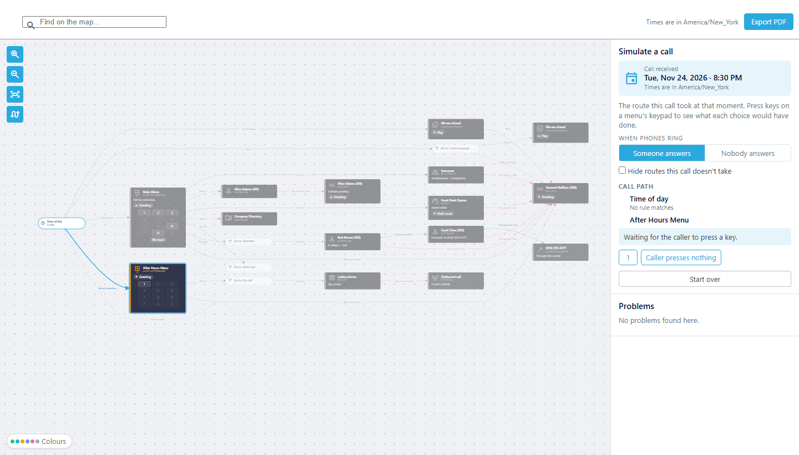

# Opening the Callflow Simulator from other Monster apps

Another app (a call log, a CDR report, a ticketing panel) can open the simulator as a **Monster
dialog** showing one route at one moment: the route a call took, simulated at the moment it
came in. The callflow and the time are fixed in that view. Menus stay pressable, because call
logs don't record which keys the caller pressed: whoever is looking can try each key and see
where it leads.



## The pub/sub API

Once the simulator is loaded, it listens on two Monster topics:

| Topic | Arguments | Does |
| --- | --- | --- |
| `callflowSimulator.isAvailable` | `{ callback(true, { name, version }) }` | Answers, so you know it is loaded. |
| `callflowSimulator.showRoute` | see below | Opens the dialog. |

`callflowSimulator.showRoute` arguments:

| Argument | Required | Meaning |
| --- | --- | --- |
| `callflowId` **or** `number` | one of them | The route. `number` is the dialled number exactly as a call log has it: `+18455550100`, `8455550100`, `+18455550100@realm.example.com` or an extension like `101`. It is matched to a callflow the way Kazoo matches it. |
| `gregorian` / `timestamp` / `date` | no (default: now) | When the call came in. `gregorian` is Kazoo's gregorian seconds, as in CDRs (`timestamp` field). `timestamp` accepts gregorian seconds, Unix seconds or Unix ms. `date` takes a `Date` or a date string. Rules are evaluated in the account's timezone, as Kazoo does. |
| `accountId` | no | The account. Default: the account Monster is on, which follows masquerading. |
| `callerId` | no | The caller's number (`caller_id_number` in a call log). Caller-ID checks on the route then follow it, and it is filled in for a pivot test. |
| `title` | no | The dialog title (default "Call route"). |
| `callback(err, { close })` | no | Called once the dialog is showing; `close()` closes it. |

```js
monster.pub('callflowSimulator.showRoute', {
	number: cdr.to,               // or callflowId: '…'
	gregorian: cdr.timestamp,
	callerId: cdr.caller_id_number,
	title: 'Call from ' + cdr.caller_id_number
});
```

## Loading it first: `integration/callflow-simulator-client.js`

Monster binds an app's listeners only after that app has been loaded, and loading an app with
`monster.apps.load` also makes it the "active" app. That affects routing, re-rendering on
masquerade, and alt+ shortcuts. Copy [`integration/callflow-simulator-client.js`](../integration/callflow-simulator-client.js)
into your app; it handles both:

```js
var crv = require('./callflow-simulator-client')(monster);

crv.isAvailable();      // synchronous: in the account's app store and allowed for this user
crv.showRoute({ number: cdr.to, gregorian: cdr.timestamp });   // loads it if needed, then opens
```

`isAvailable()` uses the same check as Monster's app launcher: the app is in the account's app
store, and its user permissions (all / admins / specific users) include this user. Use it to
decide whether to show a "Show route" link.

### Showing the link only when it will work (Handlebars)

Compute the flag once and pass it to your template:

```js
var template = $(self.getTemplate({
	name: 'call-log',
	data: { calls: calls, canShowRoute: crv.isAvailable() }
}));
template.on('click', '.show-route', function() {
	var call = calls[$(this).data('index')];
	crv.showRoute({ number: call.to, gregorian: call.timestamp });
});
```

```handlebars
{{#each calls}}
  <tr>
    <td>{{caller_id_number}}</td>
    <td>{{to}}</td>
    {{#if @root.canShowRoute}}
      <td><a href="#" class="show-route" data-index="{{@index}}">Show route</a></td>
    {{/if}}
  </tr>
{{/each}}
```

Or register a helper once:

```js
Handlebars.registerHelper('ifCallflowSimulator', function(options) {
	return crv.isAvailable() ? options.fn(this) : options.inverse(this);
});
```

```handlebars
{{#ifCallflowSimulator}}<a href="#" class="show-route">Show route</a>{{/ifCallflowSimulator}}
```

## Notes

- **Read-only**: the dialog changes nothing in Kazoo.
- **Speed**: the dialog fetches the account's lists once and reuses them for five minutes, so
  opening call after call from a log is quick. Each route fetches only what it needs.
- **What it can't know**: menu keys pressed, who answered, and anything decided at call time by
  Pivot or webhooks. Time-of-day rules, holidays, start/end dates, forced rules and jumps are all
  reproduced. Manual switches (night mode) show their position today; flip them under Switches
  to see the other way.
- **Today's configuration**: the map shows the callflow and rules as they are now, evaluated at
  the call's moment. If they changed since the call, it shows what that call would do today.
- **Development Monster**: with `bypassAppStorePermissions: true` the app opens without being
  in the app store, but `isAvailable()` is still false until it is registered (or already
  loaded). That's correct: production users only get it from the app store.
